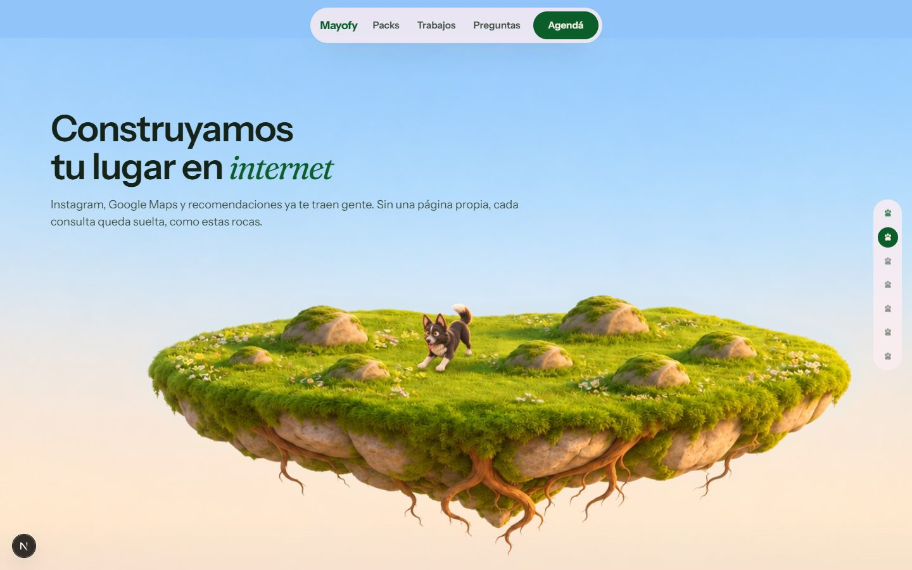
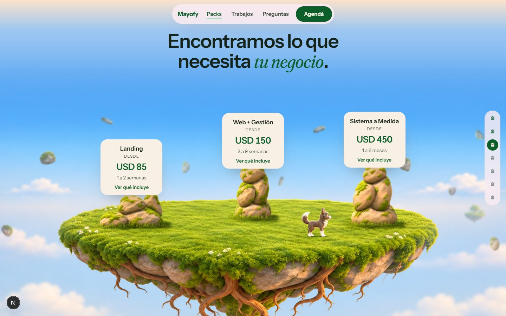
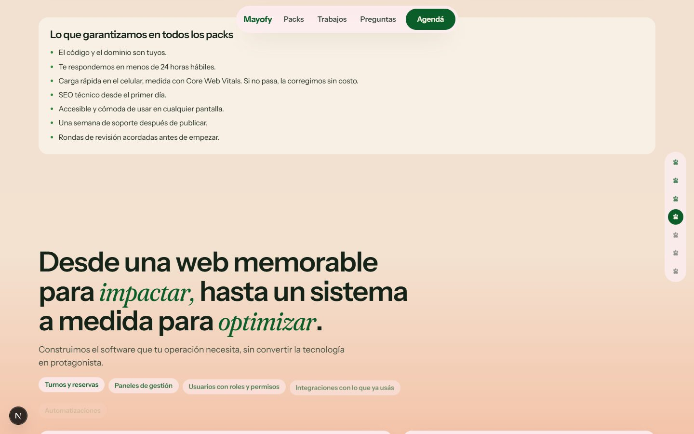
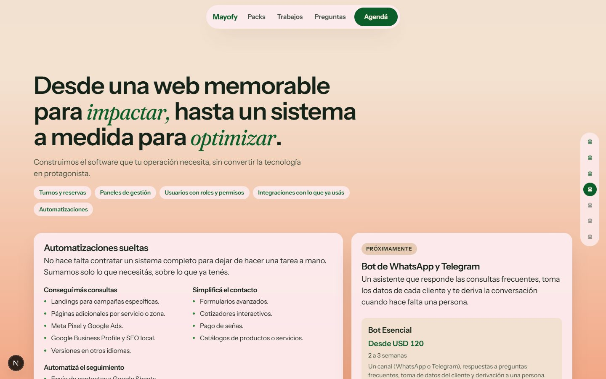
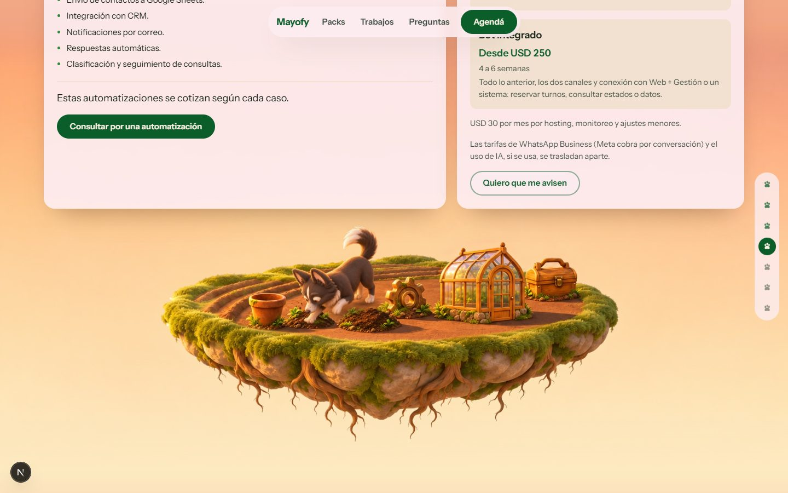
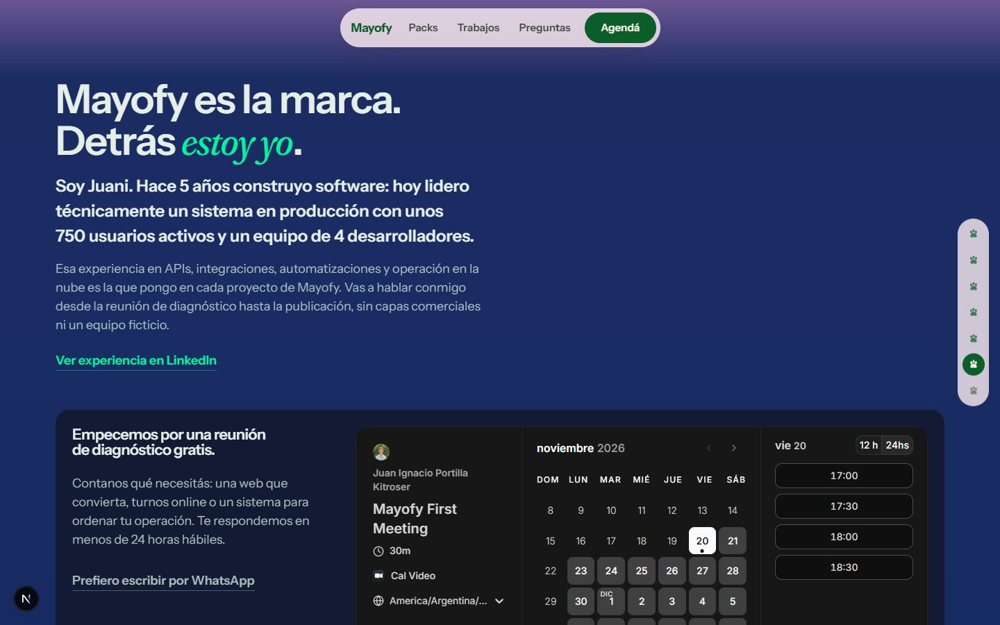
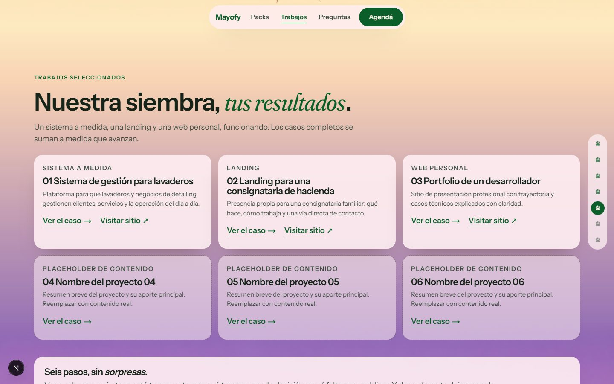
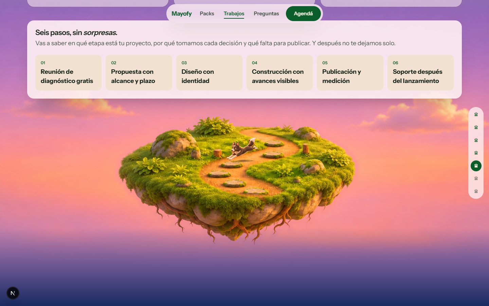

# Propuestas de diseño: islas 2 a 6 (pedidos del 20 de noviembre)

**Fecha:** 20 de noviembre de 2026
**Rama:** `juanikitro/landing-propuestas`, creada desde `juanikitro/landing-redesign` (`d14d5ba`). No toca `src/`: son propuestas para que Juani elija y otro agente construya.
**Método:** skill `design-taste-frontend` como criterio (una idea por pantalla, bordes parejos, nada de carruseles ni pestañas con temporizador, hover que responde, movimiento reducido respetado, sin leyendas debajo de las imágenes) y revisión del sitio integrado (`http://localhost:3010`) en Chromium a 1440 × 900 y 390 × 844.
**Se respeta lo aprobado:** mundo de islas flotantes que avanza con el scroll, placas pintadas, Mayo (que nunca habla), una isla por mensaje, tres packs, Cal.com integrado. Cuando una opción acorta o reordena texto, lo digo en **Copy**.

## Cómo ver los mockups

Los mockups son HTML estáticos en `docs/plans/propuestas/` que usan los tokens, las fuentes (Instrument Sans y Fraunces), las placas y las tiras de Mayo reales de `public/images/mundo-mayo/`. Para abrirlos con las imágenes:

```bash
python -m http.server 8765        # desde la raíz del repo
# http://127.0.0.1:8765/docs/plans/propuestas/11-pasos.html
```

Cada archivo tiene las opciones A, B y C una debajo de otra. `?opt=a` muestra solo una; `?p=0.5` congela el progreso de scroll de las opciones animadas; `?reduced` muestra el estado con movimiento reducido.

- Capturas por opción: `docs/plans/propuestas/capturas/<pedido>-<opción>-<1440|390>.png`.
- Secuencias de cuadros de las opciones con movimiento: `docs/plans/propuestas/capturas/secuencias/`.
- Estado actual (diagnóstico): `docs/plans/propuestas/antes/` (`d-` 1440 × 900, `m-` 390 × 844).
- Capturas de los tres sitios publicados (para los mockups de trabajos): `docs/plans/propuestas/img/`.

**Esfuerzo:** S = medio día o menos; M = uno o dos días; L = más, o depende de un asset nuevo.

## Resumen de recomendaciones

| Pedido | Recomendación | Esfuerzo |
| --- | --- | --- |
| 5 · Isla 2, utilidad | **A · Elegí tu caso**: tres situaciones (las rocas) que recomiendan un pack y llevan a su tarjeta | M |
| 7 · Isla 3, tarjetas sobre las rocas | **A · Marcadores de una línea**: "Landing · USD 85 ↓" sobre cada plataforma | S |
| 9 · Garantías | **B · Una franja pegada a los packs**, con la garantía de velocidad primero | S |
| 9 · Isla 4, "Desde una web memorable…" | **A · El taller como mapa**: los cuatro objetos pintados son las cuatro ofertas; entra en una pantalla | M |
| 9 · Isla 6, "Mayofy es la marca" | **A · Junto al fuego** sumando la fila de tres datos de B | M |
| 10 · Trabajos | **A · Índice con vista previa** flotando sobre una roca | M |
| 11 · Seis pasos | **A · El sendero de seis piedras**: Mayo avanza de piedra en piedra en la isla 5 mientras se lee cada paso | M |

---

## 5 · Isla 2: "Construyamos tu lugar en internet"

> "de la isla 2, elimina las pills de instagram, google maps, recomendaciones [done]. tambien quiero que analices, pienses y propongas que podemos hacer para mejorar la utilidad de esa seccion"

### Diagnóstico



- Sin las etiquetas, la isla tiene un título y una oración. Ocupa una pantalla entera (900 px en escritorio, 844 en celular) y no ofrece ninguna acción ni lleva a ningún lado: es solo narrativa.
- La oración nombra un problema ("cada consulta queda suelta, como estas rocas") pero no ayuda a decidir nada. La isla siguiente ya es de precios, así que este es el lugar natural para orientar.
- En celular (`antes/m-problema.jpg`) quedan ~300 px de cielo vacío entre el texto y la isla.

### Opciones

**A · Elegí tu caso** (`05-isla2.html?opt=a`, `capturas/05-a-1440.png`, `05-a-390.png`)

- **Qué es:** tres botones con una situación cada uno ("Me encuentran, pero no tengo dónde mostrar lo que hago", "Paso el día coordinando turnos por WhatsApp", "Mi operación vive en planillas y ya no alcanza"). Al elegir uno aparece una tarjeta con el pack que conviene, su precio y plazo, "Ver qué incluye" (va a la tarjeta completa) y "Agendá tu diagnóstico".
- **Por qué es mejor:** convierte una sección decorativa en un paso útil: el visitante se reconoce y llega a la isla 3 sabiendo qué mirar. Las situaciones salen del "Ideal para" de cada pack, no son inventadas.
- **Isla y Mayo:** cada botón lleva una de las rocas sueltas pintadas (`33-isla2-roca-*`); la isla queda a la derecha y Mayo juega. Al implementarlo, la roca elegida puede "ordenarse" (bajar y asentarse) en la escena.
- **Movimiento:** la tarjeta del resultado entra en 260 ms (sube 8 px). Nada se mueve solo. Con movimiento reducido, cambio instantáneo.
- **Celular:** botones a todo el ancho, resultado debajo, la isla al pie.
- **Accesibilidad:** botones nativos con `aria-pressed`; el resultado en una región `aria-live`.
- **Copy:** nueva entrada ("¿Qué te está pasando hoy? Elegí lo que más se parece y te mostramos por dónde empezar.") y las tres situaciones; reemplaza la oración actual. Se mantiene el título.
- **Esfuerzo:** M. **Riesgo:** que alguien no se reconozca en ninguna de las tres; el pie puede sumar "¿No es ninguno? Agendá tu diagnóstico".

**B · Las preguntas encuentran su lugar** (`?opt=b`, secuencia `capturas/secuencias/05-b-1440.jpg` y `05-b-390.jpg`)

- **Qué es:** sección fijada (~2,6 pantallas de scroll). Cuatro burbujas con preguntas reales de clientes ("¿Cuánto sale?", "¿Tenés turno el jueves?"…) flotan como las rocas y, con el scroll, vuelan a un celular que muestra "tu página" con cada respuesta, hasta que aparece el botón de WhatsApp.
- **Por qué es mejor:** muestra en vez de decir qué resuelve una página propia; es el momento más vistoso de las tres opciones.
- **Isla y Mayo:** las preguntas reemplazan a las rocas sueltas como "desorden"; Mayo juega en la isla debajo del celular.
- **Movimiento:** atado al scroll (CSS `animation-timeline: view()` dentro de `@supports`, como el ensamble de la isla 3). Reducido: celular completo y sin burbujas.
- **Celular:** el celular al centro sobre la isla; funciona, pero la pantalla queda cargada (ver secuencia 390).
- **Copy:** entrada nueva ("Cada pregunta que hoy respondés a mano, tu página la contesta antes…"). El negocio del celular ("Estudio Ámbar", precios y barrio) es un ejemplo ilustrativo y habría que marcarlo como tal o reemplazarlo por un cliente real.
- **Esfuerzo:** M–L. **Riesgos:** alarga la página y suma otra escena fijada; Juani sacó las etiquetas de canales y esto trae de vuelta elementos flotando.

**C · Sin página / Con tu página** (`?opt=c`, `capturas/05-c-1440.png`, `05-c-390.png`)

- **Qué es:** dos columnas de tres renglones: "Hoy, sin página" (respondés lo mismo una y otra vez, la consulta se pierde, si no te recomiendan no te encuentran) y "Con tu página" (precios y horarios a la vista, WhatsApp con el mensaje listo, Google te muestra en tu zona). Debajo, "Ver los packs" y "Agendá tu diagnóstico gratis".
- **Por qué es mejor:** informativa y estática, se lee en cinco segundos y no agrega interacción. Cada beneficio sale de lo que ya incluye el pack Landing.
- **Isla y Mayo:** la isla queda debajo, como hoy; participa poco.
- **Esfuerzo:** S. **Riesgo:** es la más parecida a una landing genérica.

### Recomendación

**A.** Es la única que cambia la función de la sección (orientar hacia un pack) y usa el arte que ya existe. B queda como alternativa si Juani quiere un momento de scroll en esta isla, pero alarga la página.

---

## 7 · Isla 3: reemplazar los cuadrados de título, precio y plazo

> "en la isla 3, analiza, pensa y propone como podemos reemplazar los cuadrados que dicen el titulo + precio + tiempo estimado por algo mas simple que te lleve a las cards mas completas luego"

### Diagnóstico



- Cada cuadrado tiene cinco renglones (nombre, "Desde", precio, plazo, "Ver qué incluye") en ~175 × 160 px y repite lo que la tarjeta completa muestra justo debajo.
- Tapan la cima de las rocas, que es justo el momento "orden" de la isla.
- En 390 (`antes/m-packs-2.jpg`) miden ~115 px de ancho: "Sistema a Medida" ocupa dos renglones y los tres cuadrados compiten con el arte.

### Opciones

**A · Marcadores de una línea** (`07-isla3.html?opt=a`, `capturas/07-a-1440.png`, `07-a-390.png`)

- **Qué es:** sobre cada plataforma, una píldora de una línea con un tallito hacia la roca: "Landing USD 85 ↓". Es un enlace a `#pack-<id>`; al llegar, la tarjeta se marca con un anillo durante 1,4 s.
- **Por qué es mejor:** de cinco renglones a uno; deja ver las rocas ensambladas y conserva el dato que más pesa para decidir (el precio). El plazo vive en la tarjeta.
- **Isla y Mayo:** los marcadores aparecen cuando las rocas terminan de ensamblarse (al final del rango de scroll actual), con 80 ms de escalonado. Mayo sigue saltando de plataforma en plataforma.
- **Movimiento:** hover sube 3 px y la flecha baja 3 px; anillo en la tarjeta destino. Reducido: marcadores visibles, sin anillo animado.
- **Celular:** dos renglones cortos (nombre arriba, precio abajo) sin flecha, 44 px de alto.
- **Esfuerzo:** S. **Riesgo:** ninguno relevante.

**B · Una barra y la plataforma se ilumina** (`?opt=b`, `capturas/07-b-1440.png`, `07-b-390.png`)

- **Qué es:** sin nada sobre las rocas. Una barra de tres segmentos al pie de la isla (nombre, precio y plazo); al pasar o enfocar un segmento, su plataforma se ilumina con un halo.
- **Por qué es mejor:** la escena queda limpia del todo y la barra es un único componente claro.
- **Celular:** la barra se apila en tres renglones bajo la isla.
- **Esfuerzo:** S–M. **Riesgo:** en celular no hay hover, así que el vínculo barra–plataforma se pierde; la barra se parece a una navegación de pestañas.

**C · Carteles de madera** (`?opt=c`, `capturas/07-c-1440.png`, `07-c-390.png`)

- **Qué es:** un cartel de madera clavado al pie de cada plataforma con el nombre del pack, pintado en el estilo de las islas. El mockup usa un cartel en CSS como sustituto.
- **Por qué es mejor:** es lo más integrado al mundo (como el cartel del hero).
- **Esfuerzo:** L (asset nuevo para pintar; el texto tiene que ir en HTML encima para que sea accesible y editable). **Riesgo:** sin precio, el visitante tiene que bajar para comparar.

### Recomendación

**A.** Es lo más simple que sigue siendo útil, no necesita assets y libera las rocas.

---

## 9a · "Lo que garantizamos en todos los packs"

> "Analiza, piensa y propon formas de mejorar la seccion de 'Lo que garantizamos en todos los packs'."

### Diagnóstico



- Siete viñetas en un panel de 1280 px donde el texto ocupa la mitad izquierda: se lee como letra chica, debajo de la línea de pago.
- La garantía más fuerte (si la web no carga rápido, la corrigen sin costo) está tercera y con el mismo peso que "SEO técnico desde el primer día".
- Está separada de las tarjetas de packs por la línea de pago, así que no se lee como parte de la oferta.

### Opciones

**A · Tres promesas** (`09a-garantias.html?opt=a`, `capturas/09a-a-*.png`): las siete garantías agrupadas en "Es tuyo", "Rápida y encontrable" y "No te dejamos solo", en tres paneles. Ordena, pero ocupa más alto que hoy (en celular, tres paneles apilados). **Copy:** agrega los tres títulos de grupo; las garantías quedan textuales. **Esfuerzo:** S.

**B · Una franja pegada a los packs** (`?opt=b`, `capturas/09a-b-*.png`)

- **Qué es:** una franja "En todos los packs" justo debajo de las tres tarjetas (antes de la línea de pago) con siete sellos cortos; el primero, resaltado: "Carga rápida en el celular o la corregimos gratis".
- **Por qué es mejor:** se lee como parte de la oferta, ocupa una sola fila en escritorio y pone primero la garantía que baja el riesgo de comprar.
- **Celular:** los sellos se apilan, uno por renglón, con la garantía de velocidad arriba.
- **Copy:** acorta cada garantía a un sello ("Código y dominio tuyos", "Respuesta en menos de 24 h hábiles"…). El texto completo puede quedar en `commercial-plans.ts` y en la FAQ.
- **Esfuerzo:** S. **Riesgo:** se pierde la mención a Core Web Vitals en la franja (puede ir en un `title` o en la FAQ).

**C · La promesa grande** (`?opt=c`, `capturas/09a-c-*.png`): la garantía de velocidad como frase grande ("Si tu web no carga rápido en el celular, *la corregimos sin costo*.", con "Lo medimos con Core Web Vitals, el mismo criterio que usa Google.") y las otras seis en una lista al lado. Es la más persuasiva, pero agrega casi una pantalla a una zona de packs que ya es larga. **Esfuerzo:** S.

### Recomendación

**B.** Va en la dirección de los cambios del 20 de noviembre (menos texto), lo pega a la decisión de compra y destaca la garantía más fuerte. Si Juani quiere un momento tipográfico en la isla 3, C es la alternativa.

---

## 9b · Isla 4: "Desde una web memorable para impactar, hasta un sistema a medida para optimizar"

> "Lo mismo para la seccion de 'Desde una web memorable para impactar, hasta un sistema a medida para optimizar' que me parece larga, desordenada e ineficiente donde la isla esta mal utilizada."

### Diagnóstico




- **Larga:** 1698 px en escritorio (~1,9 pantallas) y 2508 px en celular (~3 pantallas).
- **Desordenada:** título de tres renglones (17 palabras), entrada, cinco etiquetas que repiten el pack Sistema a Medida, dos paneles (automatizaciones en tres grupos con 14 ítems, y el bot con dos niveles de precio) y recién al final la isla.
- **Isla mal usada:** la isla aparece después de todo el contenido y no tiene relación con él. Sin embargo, tiene **cuatro objetos pintados** (maceta, engranaje, invernadero y caja de herramientas) que calzan con las cuatro cosas que vende la sección.

### Opciones

Las tres usan el mismo mapeo de objetos: **invernadero** = sistema a medida; **maceta** = conseguí más consultas; **caja de herramientas** = simplificá el contacto; **engranaje** = automatizá el seguimiento. El bot queda como una franja "Próximamente".

**Copy común:** título más corto, "Sistemas y automatizaciones *a medida*.", y entrada acortada ("Lo que tu operación necesita, sin convertir la tecnología en protagonista."). Las etiquetas desaparecen (sus ítems pasan al invernadero). Los ítems de automatizaciones se acortan un poco ("Contactos a Google Sheets", "Avisos por correo"). Si Juani prefiere conservar su título, las opciones funcionan igual, pero el título actual ocupa tres renglones en escritorio.

**A · El taller como mapa** (`09b-isla4.html?opt=a`, `capturas/09b-a-1440.png`, `09b-a-390.png`)

- **Qué es:** la isla grande a la derecha con cuatro marcadores sobre sus objetos ("Sistema a medida", "Más consultas", "Seguimiento automático", "Contacto simple"). El que se elige abre su contenido en un panel a la izquierda (abre "Sistema a medida" por defecto). El bot va en una franja al pie.
- **Por qué es mejor:** toda la sección entra en **una pantalla** en escritorio (hoy son ~1,9) y la isla pasa a ser la interfaz, no un adorno al final.
- **Isla y Mayo:** el objeto elegido se ilumina con un halo; Mayo sigue escarbando entre la maceta y el engranaje.
- **Movimiento:** cambio del panel en 200 ms; halo con fundido. Nada se mueve solo. Reducido: sin transición.
- **Celular:** título, panel abierto, isla con marcadores cortos ("Seguimiento", "Contacto") y franja del bot; ~1,3 pantallas (hoy ~3).
- **Accesibilidad:** los marcadores son botones con `aria-expanded` y `aria-controls`; el panel, `aria-live`.
- **Esfuerzo:** M. **Riesgo:** tres de las cuatro ofertas quedan detrás de un clic. Si Juani quiere todo visible, la opción es C.

**B · La isla queda fija y se ilumina** (`?opt=b`, secuencias `capturas/secuencias/09b-b-1440.jpg` y `09b-b-390.jpg`)

- **Qué es:** narración con scroll: la isla queda fija a la izquierda mientras a la derecha pasan cuatro bloques cortos; el bloque del centro de la pantalla ilumina su objeto y su marcador.
- **Por qué es mejor:** se lee de a una idea, con la isla siempre a la vista.
- **Celular:** la isla fija arriba (42 % del alto) y los bloques pasan debajo.
- **Esfuerzo:** M. **Riesgo:** sigue siendo larga (~3,5 pantallas de scroll en escritorio), justo lo que Juani marcó.

**C · Cuatro tarjetas, cada una con su objeto** (`?opt=c`, `capturas/09b-c-1440.png`, `09b-c-390.png`)

- **Qué es:** primera pantalla con título e isla (Mayo escarbando) y debajo cuatro tarjetas cortas, cada una coronada por el recorte pintado de su objeto (`43-isla4-*.webp`), con hasta cuatro ítems. Al pie, la franja del bot y "Consultar por una automatización".
- **Por qué es mejor:** todo visible, ordenado y corto (~1 pantalla en escritorio, ~2,3 en celular); reutiliza recortes que ya existen.
- **Esfuerzo:** S–M. **Riesgo:** la isla vuelve a ser ilustración, aunque los objetos sí comunican.

### Recomendación

**A.** Resuelve las tres quejas a la vez (larga, desordenada, isla mal usada) y entra en una pantalla. Si Juani prefiere no esconder contenido detrás de un clic, **C** es la segunda opción, más simple de construir.

---

## 9c · Isla 6: "Mayofy es la marca. Detrás estoy yo."

> "Lo mismo para Mayofy es la marca. Detrás estoy yo."

### Diagnóstico



- 2331 px en escritorio. La primera pantalla deja la mitad derecha vacía; la isla (fogón, banco y Mayo echada) aparece recién al final, después de la agenda y el formulario (`antes/d-contacto-2.jpg`).
- El texto sobre Juani son dos párrafos largos (52 y 41 palabras); los datos que generan confianza (5 años, ~750 usuarios, equipo de 4) quedan dentro del párrafo.
- La agenda, el enlace a WhatsApp y el formulario conviven en el mismo bloque y compiten entre sí.

### Opciones

**Copy común:** la entrada se acorta a "Soy Juani. Hace 5 años construyo software y hoy lidero técnicamente un sistema con unos 750 usuarios activos." y el segundo párrafo a "Vas a hablar conmigo desde la reunión de diagnóstico hasta la publicación, sin capas comerciales." (se saca "Esa experiencia en APIs, integraciones…").

**A · Junto al fuego** (`09c-isla6.html?opt=a`, `capturas/09c-a-1440.png`, `09c-a-390.png`)

- **Qué es:** la primera pantalla es la presentación: texto a la izquierda y la isla grande a la derecha, con el fogón encendido y Mayo echada junto al banco. Debajo, la invitación ("Empecemos por una reunión de diagnóstico *gratis*"), WhatsApp como botón y la agenda al lado; el formulario pasa a un enlace "Prefiero completar un formulario" que lo despliega.
- **Por qué es mejor:** la isla cumple su papel narrativo (Mayo llegó a echarse junto a Juani) en la pantalla donde se habla de Juani, y la mitad vacía desaparece.
- **Isla y Mayo:** el banco queda libre para el avatar de Juani pendiente (`2026-11-16-landing-redesign-mayo-world.md`, "Pendiente para después").
- **Movimiento:** el brillo del fogón que ya existe. Reducido: quieto.
- **Celular:** texto, isla, invitación, agenda.
- **Esfuerzo:** M (reordenar y plegar el formulario; la agenda ya está medida en `2026-11-19-revision-diseno.md`).

**B · Tres datos** (`?opt=b`, `capturas/09c-b-1440.png`, `09c-b-390.png`): los tres datos como cifras grandes en Fraunces menta ("5 años", "750", "4") con su aclaración, y un solo párrafo corto. Es la que mejor comunica experiencia, pero deja la isla otra vez abajo. **Esfuerzo:** S.

**C · Primero la charla** (`?opt=c`, `capturas/09c-c-1440.png`, `09c-c-390.png`): presentación breve (avatar, una línea y los datos como etiquetas) a la izquierda y la agenda a la derecha **en la primera pantalla**; el formulario plegado en "¿Preferís escribir?". Es la más orientada a convertir, pero achica la presentación de Juani. **Copy:** agrega la línea "Desarrollador de software, a cargo de cada proyecto." (a validar). **Esfuerzo:** S–M.

### Recomendación

**A, sumando la fila de tres datos de B** debajo de la entrada. Ordena la isla en dos partes claras (quién soy / agendá), baja de ~2,6 a ~1,3 pantallas en escritorio (con el formulario plegado) y usa la isla donde corresponde.

---

## 10 · Trabajos: "Nuestra siembra, tus resultados"

> "analiza piensa y propon distintas formas (mas interesantes) de mostrar los proyectos de 'Nuestra siembra, tus resultados' que no sea la actual."

### Diagnóstico



- Seis tarjetas de texto en una grilla de 3 × 2; tres son marcadores ("Placeholder de contenido", "Nombre del proyecto 04"), así que la mitad de la sección muestra que falta contenido.
- Ninguna imagen: el trabajo de un estudio web se muestra sin mostrar las webs.
- Otro agente está agregando imágenes de prueba con un carrusel dentro de las tarjetas. Ojo: el criterio del skill desaconseja los carruseles (esconden contenido y no se leen en celular); las opciones de abajo muestran una imagen principal por proyecto.

Los mockups usan capturas reales de los tres sitios publicados (`img/`). La de ShineApp es su pantalla de acceso: para cualquier opción hace falta una captura del panel por dentro.

### Opciones

**A · Índice con vista previa** (`10-trabajos.html?opt=a`, `capturas/10-a-1440.png`, `10-a-390.png`, secuencia de hover `capturas/secuencias/10-a-1440-hover.jpg`)

- **Qué es:** una lista con los títulos grandes (número en Fraunces, título y categoría) y, a la derecha, una ventana de navegador con la captura del proyecto (más su versión de celular) flotando sobre una roca pintada. Pasar o enfocar un título cambia la vista previa. Clic: "Ver el caso".
- **Por qué es mejor:** entra en una pantalla, los títulos se leen de un vistazo, la imagen es grande y escala a más proyectos sin cambiar el diseño. Los marcadores 04–06 se esconden hasta tener contenido ("Los casos completos se suman a medida que avanzan.").
- **Isla y Mayo:** la vista previa flota sobre una roca de la isla 2/3 con un vaivén lento de 6 s (en reposo con movimiento reducido).
- **Movimiento:** la fila activa se corre 12 px y muestra la flecha; la captura cambia con fundido. No hay temporizador ni carrusel: solo responde al visitante.
- **Celular:** sin hover, cada fila lleva su captura arriba del título.
- **Esfuerzo:** M. **Riesgo:** en pantallas táctiles grandes (tablet) la vista previa se elige con el primer toque; conviene que el primer toque la muestre y el segundo abra el caso, o que la fila entera sea el enlace.

**B · Un caso destacado y dos más** (`?opt=b`, `capturas/10-b-*.png`): la consignataria grande (navegador y celular superpuestos, texto y enlaces) y abajo dos tarjetas con su captura; hover: la tarjeta sube 2 px y la imagen hace zoom 1,03. Clara y simple, pero obliga a elegir un caso estrella. **Esfuerzo:** S–M.

**C · Una isla por caso** (`?opt=c`, `capturas/10-c-*.png`): cada proyecto "plantado" en su propia islita flotante (la base vacía de la isla 3, `10-isla3-base-isla.webp`), en zigzag sobre el atardecer, con vaivén desfasado y Mayo corriendo en una. Es la más fiel al mundo, pero ocupa ~2,5 pantallas y repite la base tres veces. **Esfuerzo:** M–L.

### Recomendación

**A.** Es la más interesante sin perder claridad, entra en una pantalla y no depende de llenar seis lugares. C queda como alternativa si Juani quiere que trabajos sea un momento del mundo.

---

## 11 · "Seis pasos, sin sorpresas"

> "Analiza piensa y propon una animacion y presentacion mejor de 'Seis pasos, sin sorpresas'"

### Diagnóstico



- Un panel con seis cajas iguales en fila (número y nombre), sin explicación ni movimiento más allá de la entrada escalonada.
- Justo debajo está la isla 5 con un **sendero de seis piedras** por el que Mayo galopa, pero no tiene relación con los pasos: la coincidencia está a la vista y no se aprovecha.

### Opciones

**Copy común:** cada paso suma una línea de explicación (propuesta, a validar):

1. Reunión de diagnóstico gratis: "Charlamos 30 minutos sobre tu negocio y lo que necesitás." (la reunión de Cal.com dura 30 min).
2. Propuesta con alcance y plazo: "Te mandamos por escrito qué incluye, cuánto sale y cuándo está."
3. Diseño con identidad: "Lo ves diseñado, con tu marca y tu rubro, antes de construirlo."
4. Construcción con avances visibles: "Seguís el avance mientras lo construimos, no recién al final."
5. Publicación y medición: "Publicamos con tu dominio y dejamos medidas las visitas y consultas."
6. Soporte después del lanzamiento: "Una semana de soporte incluida; después, mantenimiento si lo querés."

La entrada se acorta a "Vas a saber en qué etapa está tu proyecto y qué falta para publicar."

**A · El sendero de seis piedras** (`11-pasos.html?opt=a`, secuencias `capturas/secuencias/11-a-1440.jpg` y `11-a-390.jpg`, reducido `capturas/11-a-1440-reducido.png`)

- **Qué es:** sección fijada de ~3,4 pantallas de scroll. A la izquierda, la lista de los seis pasos; a la derecha, la isla 5 grande con un número sobre cada piedra del sendero. Con el scroll, Mayo salta a la piedra siguiente, el número se enciende y en la lista se abre ese paso con su explicación; los pasos ya recorridos quedan marcados.
- **Por qué es mejor:** une el contenido con el arte que ya existe y le da sentido a la carrera de Mayo; cada paso tiene su momento y su explicación sin agregar cajas.
- **Isla y Mayo:** el recorrido por cuadros de la isla 5 (`mayo-route`, un keyframe por cuadro pintado, documentado en `2026-11-17-montaje-assets.md`) se parte en seis tramos, uno por paso, y Mayo se detiene sobre cada piedra. Las piedras están medidas sobre la placa de escritorio (56,2/55,5 %, 55,8/59,5 %, 47,4/62,7 %, 44,8/66,3 %, 47,8/69,7 % y 52,2/72,5 %); la placa de celular necesita sus propias medidas.
- **Movimiento:** atado al scroll, sin animaciones por tiempo. **Reducido:** los seis pasos abiertos y Mayo quieta en la última piedra.
- **Celular:** la isla arriba, debajo solo el paso actual con su explicación y una barra de seis segmentos (ver secuencia 390).
- **Accesibilidad:** la lista es un `<ol>` con los seis pasos siempre en el DOM; lo que cambia es solo el resaltado.
- **Esfuerzo:** M. **Riesgos:** otra escena fijada en la página (hay que medir el largo total); la isla 5 hoy aloja también trabajos: trabajos (pedido 10) va primero, en su pantalla, y el sendero cierra la isla.

**B · Huellas que llenan el camino** (`?opt=b`, secuencias `capturas/secuencias/11-b-1440.jpg` y `11-b-390.jpg`): un camino punteado que baja en zigzag por la sección y se llena de verde con el scroll; en cada curva, uno de los seis hitos pintados (`48-isla5-hito-*`, tres de madera y tres de piedra) con su paso, que "despierta" al llegar el trazo. Al final, la isla 5 con Mayo esperando. No fija la pantalla y en celular es una lista vertical, pero ocupa ~2 pantallas y la isla vuelve a quedar al final. **Esfuerzo:** M.

**C · Seis piedras que caen** (`?opt=c`, secuencia `capturas/secuencias/11-c-1440.jpg`): las seis piedras planas pintadas (`48-isla5-paso-*`) en fila; al entrar la sección caen una tras otra y Mayo las cruza saltando una sola vez (3,2 s en total) y queda sentada en la última. Es un momento único por tiempo, compacto (una pantalla), pero en celular la fila se vuelve una grilla de 2 × 3 y el salto se pierde. **Esfuerzo:** M.

### Recomendación

**A.** Es la que mejor usa la isla y a Mayo, cuenta el proceso de a un paso y mantiene el criterio del sitio (movimiento atado al scroll, reducido en reposo).

---

## Verificación

- Estado actual capturado en Chromium (Playwright) sobre el servidor del coordinador (`localhost:3010`, sin detenerlo) a 1440 × 900 y 390 × 844.
- Cada mockup se capturó a 1440 × 900 y 390 × 844 (página completa en celular para las opciones estáticas); las opciones con movimiento, en secuencias de 3 a 6 cuadros.
- A 390 px ningún mockup tiene scroll horizontal (`scrollWidth === innerWidth`). Los controles interactivos (botones de 5A y 9b-A, enlaces de 7, 9c y 10) se alcanzan con Tab en orden de lectura.
- No se corrió el finish gate del skill: los mockups son maquetas de opciones, no páginas para publicar.

## Límites

- Los mockups aproximan: posiciones medidas sobre las placas de escritorio; en celular se usa la misma placa escalada (el sitio tiene placas de celular de 864 × 1536 con coordenadas propias).
- La agenda de 9c es un sustituto visual del embed de Cal.com.
- El copy nuevo de cada opción es propuesta y necesita la aprobación de Juani antes de pasar a `src/content/`.
- Falta una captura del panel de ShineApp por dentro para cualquier opción de trabajos.
- El avatar de Juani para el banco de la isla 6 sigue pendiente.
