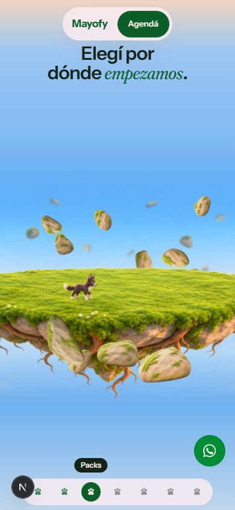
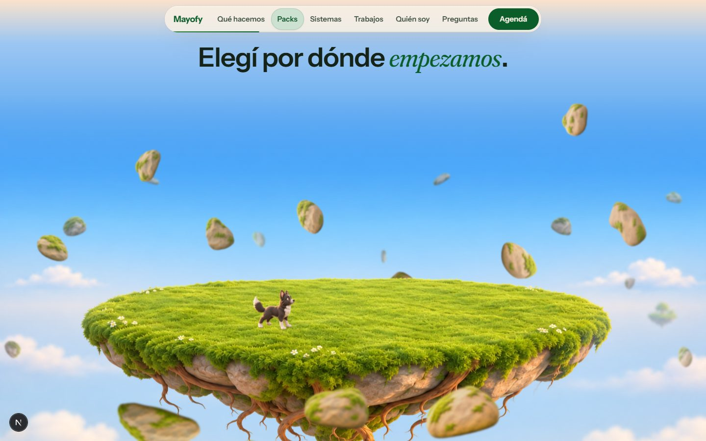
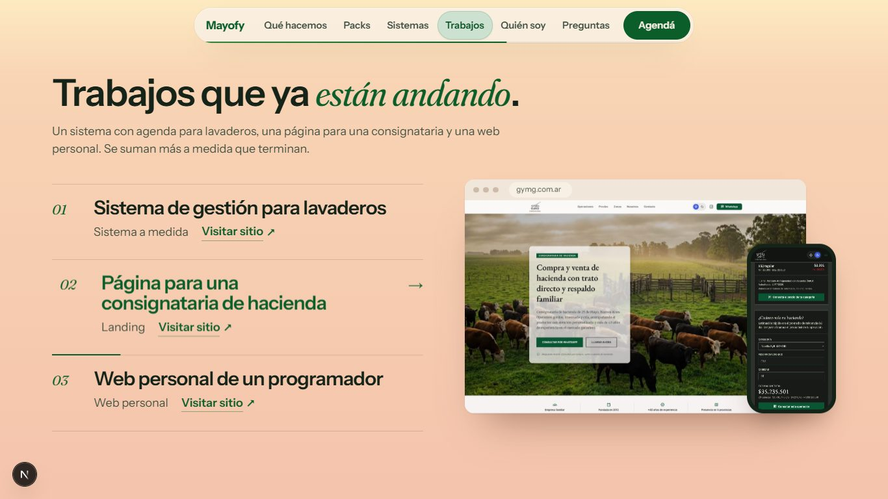
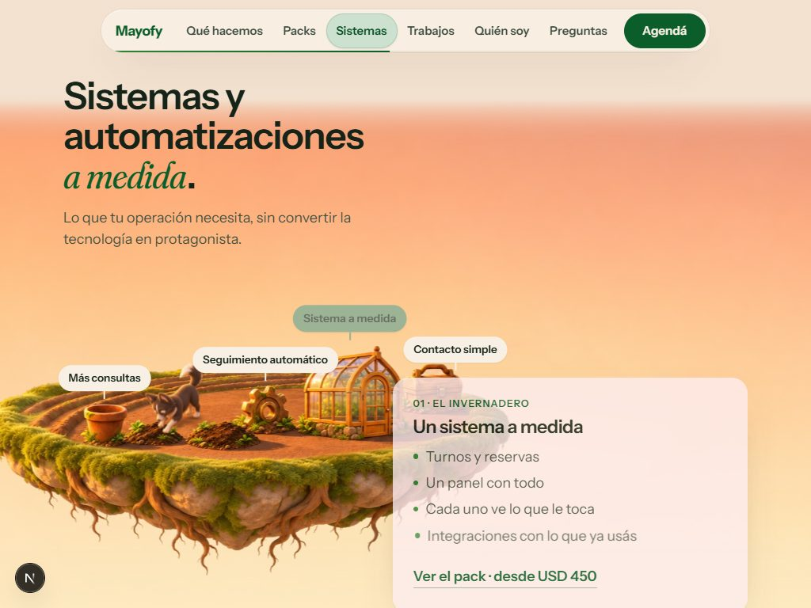
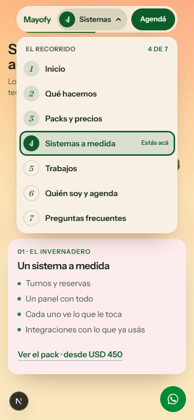
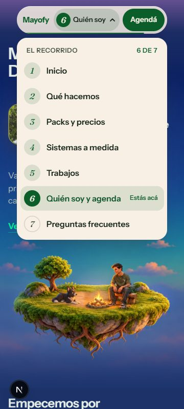
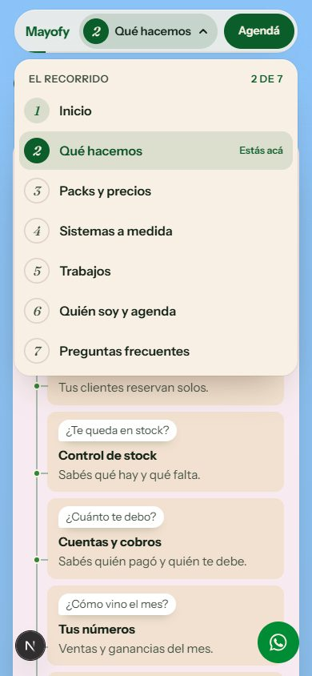
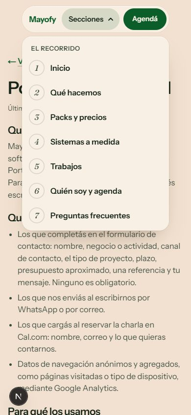

# Navegación: adiós a la barra de patitas, una píldora que sabe dónde estás

Fecha: 22 de noviembre de 2026. Rama: `juanikitro/landing-navegacion` (desde `juanikitro/landing-redesign`).

## El pedido

> "desplega otro agente especifico para eliminar la barra de patitas. En su lugar mejoraria la barra flotante de arriba para que sea igual de util pero igual de moderna y fachera" (Juani, 22/11/2026)

La barra de patitas (vertical a la derecha en la laptop, abajo en el celular) marcaba la isla actual y saltaba a cada isla. En la isla 6, a 1440 px, tapaba el retrato pintado de Juani. La prueba con usuaria simulada (`2026-11-20-prueba-usuario.md`) ya había mostrado que el menú de arriba era lo que más ayudaba y que las patitas tapaban campos del formulario.

## Qué se sacó

- `src/components/world/island-progress.tsx` (la barra y su montaje en `src/app/page.tsx`).
- Todo su CSS en `src/app/world.css`: estilos base, versión de celular, burbujas y etiquetas, el aviso de 2,5 s con el nombre de la isla, la animación de entrada, las patitas "visitadas", los objetivos de 44 px y las reglas que la escondían sobre la agenda y el formulario.
- Las referencias a la barra en comentarios de otras islas.

Se conserva:

- El **botón flotante de WhatsApp** del celular, que vivía en el mismo componente: ahora es `src/components/world/whatsapp-float.tsx`, con la misma lógica (aparece después del héroe, se aparta sobre la isla 6, la agenda y el formulario, y mientras un campo tiene foco). Como ya no hay barra abajo, bajó de 4,5 rem a 1 rem del borde (más el área segura del teléfono).
- El **margen lateral de 5 rem** del inicio en pantallas anchas: existía para dejar lugar a la barra, pero todas las islas se compusieron con él (bordes izquierdo y derecho iguales, el retrato de la isla 6, la tarjeta de la isla 2). Sacarlo corría el texto 32 px a la izquierda y dejaba los bordes desparejos, así que queda, con un comentario nuevo que explica por qué.
- `use-active-island.ts`, que todavía usa el índice de casos (`study-index.tsx`).

## La nueva píldora

Un solo componente, `src/components/world/island-nav.tsx`, y un solo bloque de CSS al final de `world.css` ("Pill navigation (round 11, 2026-11-22)").

**Pantallas anchas (desde 56 rem, unos 900 px):**

- `Mayofy · Qué hacemos · Packs · Sistemas · Trabajos · Quién soy · Preguntas · Agendá`. Las seis islas, con nombres que entiende cualquiera; "Mayofy" lleva al inicio.
- Una **ficha verde suave se desliza** detrás de la isla que se está leyendo (se mueve con `transform` y ajusta su ancho; nada más se reacomoda). Sobre el héroe no hay ficha.
- Una **línea fina en el borde inferior** de la píldora se llena a medida que se baja por la página: es el "cuánto falta" que daban las patitas.
- "Agendá" queda siempre a la vista.

**Celular y tablet (menos de 56 rem):**

- `Mayofy · [4 Sistemas ▾] · Agendá`. El botón del medio muestra el número y el nombre de la isla actual.
- Al tocarlo se abre, debajo de la píldora y con su mismo ancho, **la lista del recorrido**: "El recorrido · 4 de 7", las siete islas numeradas, las ya pasadas con el número en verde y la actual marcada con "Estás acá". Tocar una isla la cierra y lleva ahí.
- Se cierra con Escape (el foco vuelve al botón), tocando afuera, saliendo con Tab o eligiendo una isla. Las flechas arriba y abajo, Inicio y Fin recorren la lista.
- La misma línea de progreso en el borde de la píldora.

**Cómo sabe dónde estás:** en cada cuadro en que la página se movió, la isla actual es la última cuya parte de arriba ya pasó el 35 % superior de la pantalla (`packs-detalle` cuenta como Packs). El progreso se escribe como variable CSS (`--story`) sin volver a dibujar el componente. Es más fiel que el observador anterior, que en las islas largas (320 vh) a veces marcaba la vecina.

**Enlaces:** en el inicio son `#id` comunes, así que `hash-link-history.tsx` sigue manteniendo el botón Atrás. En las otras páginas (privacidad, casos, 404) son enlaces del router a `/#id` y no muestran línea de progreso.

**Movimiento y accesibilidad:**

- Todo usa los tokens de movimiento del sitio (`--m-*`, `--ease-*`); con movimiento reducido duran 0 y no hay desplazamientos: la ficha salta, la lista aparece.
- La lista entra 6 px desde arriba y sus filas se asientan de a una (20 ms entre cada una). Todas las transiciones se pueden interrumpir.
- `aria-current="location"` en la isla actual (enlace y fila), `aria-expanded` y `aria-controls` en el botón, nombre accesible "Secciones. Estás en: Sistemas". La lista cerrada queda `inert` y oculta: no recibe toques ni foco.
- Anillo de foco visible y dentro de la píldora. Todos los objetivos miden 44 px o más (las filas de la lista, 48 px).

**Estética:** vidrio crema con un brillo de 1 px arriba y un filo cálido, la sombra que aparece al empezar a bajar (como antes), los números en Fraunces cursiva como las palabras destacadas de los títulos, el verde musgo del sitio y los radios propios (píldora y `--radius`). La lista es crema sólido, para que se lea bien sobre cualquier isla.

Dos detalles técnicos que salieron al probar:

- **El vidrio es una capa propia** (`.island-nav__glass`), no el fondo de la píldora. Con el desenfoque puesto en la píldora, la lista (que vive adentro) no podía desenfocar lo que tiene detrás y se veía el título de la isla a través.
- **El crema ahora es crema.** La mezcla anterior, `color-mix(in oklch, var(--cream) 82%, transparent)`, pierde el tono del crema y la píldora se veía lila. Ahora se usa el color relativo `oklch(from var(--cream) l c h / 84%)`, con la mezcla vieja como respaldo para navegadores sin color relativo.
- En celulares chicos (360 px) se ajustan los espacios para que "Qué hacemos", el nombre más largo, entre entero junto a "Mayofy" y "Agendá".

## Verificación

Con el servidor de desarrollo propio (puerto 3018) y Chromium de Playwright, sobre la rama ya unida con `juanikitro/landing-redesign` (00a2858, que trae la limpieza y la ronda de SEO). Los scripts quedaron en `docs/plans/navegacion/scripts/` (`recorrido.cjs`, `teclado-y-otra-ruta.cjs`, `ancho-pildora.cjs`).

En 1440x900, 1366x768, 1024x768, 390x844 y 360x800 (los dos últimos como celular, con toque), `recorrido.cjs` hace:

1. **Recorrido real con la rueda**, de a 300 px con pausas, de arriba hasta el final. En cada paso compara la isla que cruzó la línea de lectura con la que marca la píldora (enlace con `aria-current` o número del botón). Resultado en los cinco tamaños: pasa por las siete islas en orden, la marca sigue a la lectura sin desfases entre muestras estables, la línea de progreso termina en 1 y no hay desborde horizontal en ningún momento.
2. **Saltos** a las seis islas desde la píldora (en celular, abriendo la lista y tocando cada isla). En todos: la dirección cambia a `#id`, se llega a esa isla, la píldora la marca, la lista se cierra sola y el título de la isla queda debajo de la píldora, nunca tapado.
3. **Atrás** dos veces después de los saltos: vuelve a `#contacto` y después a `#trabajos`, sin salir de la página.
4. **Teclado** (celular): Enter abre la lista (`aria-expanded="true"`) con el foco en una isla, la flecha abajo pasa a la siguiente, Escape la cierra y devuelve el foco al botón; tocar afuera la cierra; salir con Tab la cierra. En escritorio el orden de Tab es: saltar al contenido, Mayofy, las seis islas, Agendá y después el contenido; el anillo de foco se ve en todos.
5. **Objetivos de toque:** ningún enlace ni botón de la píldora o de la lista mide menos de 44 px de alto.
6. **Errores de consola:** cero en todas las pasadas.

Además:

- **Movimiento reducido** (390, `prefers-reduced-motion: reduce`): la misma pasada completa sin fallas; las transiciones de la lista duran 0 s.
- `teclado-y-otra-ruta.cjs`: abriendo la lista con el teclado en la isla 4, el foco cae en "4 Sistemas a medida · Estás acá". En `/privacidad` la píldora muestra "Secciones", sin línea de progreso, y elegir "Packs y precios" lleva a `/#packs` con la píldora marcando Packs.
- **Isla 6:** a 1440 y a 390 no hay nada encima del retrato de Juani ni de la agenda (capturas c03 y c07). El botón de WhatsApp sigue escondiéndose sobre la isla 6.
- `npm run lint`, `npm run typecheck` y `next build`: sin errores.

## Límites

- Navegador emulado: Chromium de escritorio en modo headless, con emulación de celular. No se probó en un iPhone ni en un Android reales, ni con un lector de pantalla real (sí se revisaron los nombres accesibles, `aria-current`, `aria-expanded` e `inert`).
- La píldora de escritorio es más ancha que antes (unos 770 px con las seis islas). Entre 900 y 1024 px entra con margen; por debajo de 56 rem cambia al botón con la lista.
- La ficha que se desliza anima su ancho además de su posición (un solo elemento posicionado, no reacomoda nada más). Es la única excepción a la regla del sitio de no animar anchos.
- La píldora no se esconde sobre el formulario: arriba de la pantalla no tapa campos, y los campos ya se detienen debajo de ella al recibir foco (`scroll-margin`). Lo que se aparta sobre el formulario y la agenda es el botón de WhatsApp, como antes.
- El margen lateral de 5 rem del inicio queda como estaba (ver "Qué se sacó"). Si algún día se quiere aprovechar el ancho que dejaba la barra, hay que revisar isla por isla.
- Los nombres ("Qué hacemos", "Quién soy y agenda", etc.) son una propuesta en lenguaje simple; Juani puede cambiarlos en `src/components/world/island-nav.tsx`.
